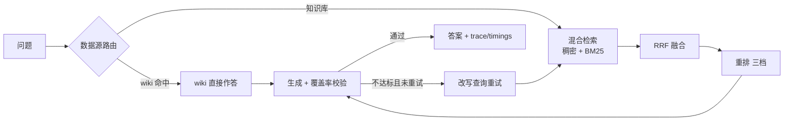

# 模块化 RAG 服务 · ragkit


> 混合检索（稠密 + BM25 → RRF 融合 → 可选重排）+ Corrective/Adaptive 编排 +
> 多模态入库（PDF / 图片 / 图搜图），检索质量可量化评测，全链路带 trace 与耗时。

## 一条请求的完整链路



## 功能

| 能力 | 机制 | 代码位置 |
| --- | --- | --- |
| 混合检索 | Milvus HNSW 稠密 + BM25 稀疏，RRF(k=60) 融合 | `src/ragkit/retrieval/` |
| 重排 | 三档：关闭 / 词面重排（离线）/ 外部 API 重排 | `src/ragkit/retrieval/rerank.py` |
| 数据源路由 | 规则路由：知识库 / wiki / 联网兜底，可关 | `src/ragkit/graph/router.py` |
| Corrective 编排 | 生成后校验覆盖率（≥0.3），不达标改写查询重试（≤1 次） | `src/ragkit/graph/nodes.py` |
| wiki 增强层 | 语料编译成主题页，命中（score≥0.6 且 coverage≥0.2）直接作答 | `src/ragkit/wiki/` |
| 多模态入库 | PDF 解析（OCR 三档：none / rapidocr / dots）、图片裁切落盘（md5 去重）、VLM 生成描述（带缓存） | `src/ragkit/multimodal/` |
| 图搜图 | 图片向量独立字段 `dense_img`；`POST /search-image` | `src/ragkit/api/server.py` |
| 图文回答 | 命中图片块时把图（≤3 张）交给视觉模型，失败自动降级纯文本 | `src/ragkit/graph/nodes.py` |
| 增量同步 | Connector 抽象 + md5 变更检测 + JSON 断点账本；先删后写，失败重放 | `src/ragkit/connectors/` |
| ACL 权限过滤 | 文档 front-matter 声明权限组，检索前置过滤（Milvus `json_contains_any`，先过滤后算相似度） | `src/ragkit/retrieval/` + `src/ragkit/ingest/loader.py` |
| 可量化评测 | recall / hit / MRR / 覆盖率 / 延迟，逐题 A/B diff，按六类细分（fact / paraphrase / multi_hop / numeric / cross_doc / negative） | `src/ragkit/eval/` |
| 全链路观测 | 每次问答带 trace 与 timings（per-node 耗时），`--json` 可打印 | `src/ragkit/graph/state.py` |

## 运行模式

| 模式 | 向量库 | Embedding | 生成 | 说明 |
| --- | --- | --- | --- | --- |
| 离线 | 内存库 | 哈希 | 抽句式 | 零依赖跑通全链路、CI 与单测 |
| 本地 | Docker Milvus | OpenAI 兼容接口 | DeepSeek 等 | 真实混合检索 + 生成 |
| 生产 | Milvus 集群 | 同上 | 同上 | 另需鉴权 / 网关 / 会话存储 |

离线实现与真实实现共用同一套接口（`Embeddings` / `VectorStore` Protocol），切换只改配置，不改代码。

## 快速开始

```bash
pip install -e ".[runtime]"

# 离线跑通全链路（无外部依赖）
python scripts/demo.py

# 真实模式：先起 Milvus，再入库
docker compose up -d
python scripts/ingest.py --recreate

# 语料更新后增量入库（只处理变更文件，账本在 data 目录下）
python scripts/ingest.py --incremental

python scripts/query.py "什么是 Flink Checkpoint" --json

# HTTP 服务（Swagger 在 /docs）
python scripts/serve.py
```

配置走环境变量（前缀 `RAG_`，双下划线分层，见 `.env.example`），无 `.env` 时使用默认值。

## 测试与评测

```bash
pip install -e ".[dev]"
pytest                     # 153 个用例，全离线，CI 同款
python scripts/eval.py --memory   # 产出 reports/eval_report.{md,json}
```

## 设计要点

- **检索组件可替换**：embedding / 向量库 / 重排都是 Protocol 接口，离线实现用于测试与 CI，真实实现只差一份配置。
- **降级而非失败**：OCR 不可用回落文本层、视觉模型失败回落纯文本、路由不可用回落知识库、wiki 未命中回落检索——每一级降级都有观测点。
- **重试有上限**：Corrective 改写重试最多 1 次，避免循环放大成本。
- **评测先行**：改检索参数前先跑 `eval_offline.py --a-b` 拿逐题 diff，不做无对照的调优；评测集 40 条按六类细分，平均值掩盖不了的"某类题全面变差"靠分类表看。
- **权限在检索前过滤**：用户组作为 Milvus search 表达式前置下发，不召回后筛（后筛会把 top_k 筛空）；内存实现与 Milvus 表达式语义对齐，单测防行为分叉。

## 已知限制

- 离线档（哈希 embedding）只验证流程正确性，中文语义命中质量差，不能评估检索质量。
- `dashscope-mm` 图文 embedding 按官方接口实现，尚未接入真实 Key 验证；接入后应先用 `data/eval/eval_set_multimodal.jsonl` 跑 `ragkit-eval`。
- 会话历史存内存，重启即失；生产需外接 Redis。
- ACL 为单租户简化版（文档级权限组），未做行级权限、限流与多租户隔离。
